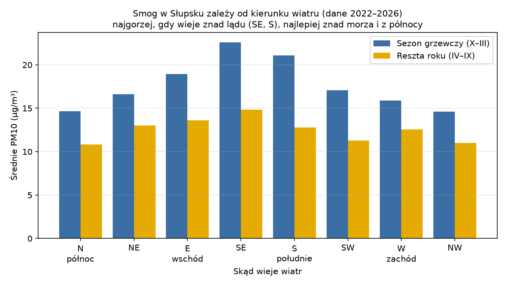
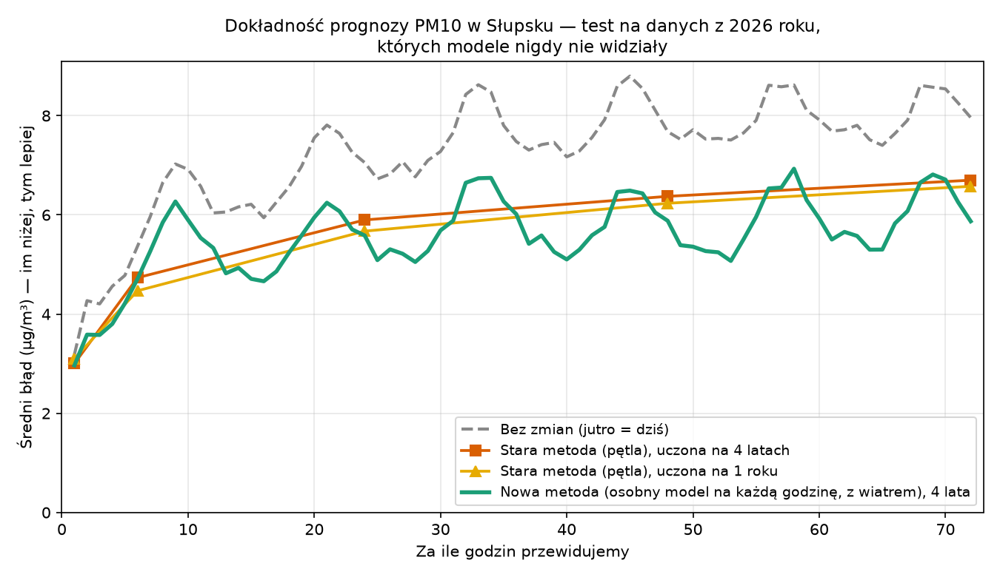

# Jak poprawiliśmy prognozę smogu — opis dla uczniów i komisji

Ten dokument tłumaczy prostym językiem, **co zmieniliśmy w SmogGuardAI, po co i co z tego wyszło**.
Wszystkie liczby pochodzą z eksperymentów, które można powtórzyć kilkoma komendami (rozdział 14).

## 1. Co robi program

SmogGuardAI przewiduje **stężenie pyłu PM10 w Słupsku na najbliższe 72 godziny**.
Uczy się na pomiarach z oficjalnej stacji GIOŚ (ul. Kniaziewicza) i na pogodzie z IMGW
(przede wszystkim ze stacji w Ustce, z Koszalina i Chojnic tylko jako zapasu).

**Jak mierzymy błąd?** Podajemy *średni błąd bezwzględny* (MAE) w µg/m³. Przykład: MAE = 5
oznacza, że prognoza myli się średnio o 5 µg/m³. Dla porównania średnie PM10 w naszych danych
to około 15,5 µg/m³.

## 2. Z czym porównujemy: prognoza „bez zmian”

Żeby wiedzieć, czy model w ogóle się przydaje, porównujemy go z najprostszym „zgadywaniem”:
**„za 24 godziny będzie tak samo jak teraz”**. Jeśli model nie jest lepszy od takiego zgadywania,
nie ma sensu. Na wykresie to szara przerywana linia.

## 3. Jak uczciwie sprawdzamy model (ważne dla komisji)

Najczęstszy błąd w projektach z uczeniem maszynowym: model sprawdza się na tych samych danych,
na których się uczył, więc wynik jest **zbyt dobry**. To jak sprawdzian z zadań, które uczeń
widział wcześniej.

Dlatego w eksperymentach robimy tak:

1. Model uczy się **tylko na danych do 31.12.2025**.
2. Sprawdzamy go na danych **od 1.01.2026 do 29.10.2026**, których nigdy nie widział.
3. Punktów startowych do prognozy jest **477** (co 12 godzin, tylko takie, gdzie mamy pełne dane
   z poprzednich 24 godzin i prawdziwe pomiary z następnych 72 godzin).
4. Gdy pytamy „czy to naprawdę lepsze?”, nie patrzymy tylko na średnią. Używamy **testu parowego
   z losowaniem (bootstrap)**: porównujemy obie metody na tych samych godzinach i sprawdzamy, czy
   przedział niepewności różnicy omija zero. Jeśli nie omija, różnica może być zwykłym szumem.

> **Uwaga o starszych liczbach.** Wcześniejszy „backtest” w panelu (np. MAE ≈ 2,7) liczył błąd
> także na danych, na których model się uczył. Te liczby są optymistyczne. Rzetelne wyniki są
> w tym dokumencie.

## 4. Krok 1: więcej danych (4 lata zamiast 10 miesięcy)

Wcześniej model znał tylko około 10 miesięcy (od grudnia 2025). Pobraliśmy z archiwów:

- **PM10 z GIOŚ od 2022 roku:** prawie 40 tysięcy godzin prawdziwych pomiarów,
- **pogodę z IMGW od 2022 roku:** 3 stacje, każda godzina.

Przy okazji znaleźliśmy i naprawiliśmy błąd: IMGW w 2024 roku zapisuje nazwy stacji z dodatkowymi
spacjami (np. „KOSZALIN” z kilkunastoma spacjami na końcu), przez co program „nie widział” całego roku pogody.

**Wynik (zaskakujący):** dłuższa historia nie poprawia starej metody przy prognozie na 24–72
godziny (MAE na 72 h: 6,58 po 1 roku nauki i 6,70 po 4 latach). Zamiast to ukrywać,
potraktowaliśmy to jako wskazówkę, że problem leży w *metodzie*, a nie w ilości danych.

## 5. Krok 2: nowa metoda prognozy

**Stara metoda (pętla).** Model umie przewidzieć tylko **następną godzinę**. Żeby przewidzieć
72 godziny, używa własnej prognozy jako danych do kolejnej: godzina 1 → godzina 2 → … → godzina 72.
Każdy mały błąd jest przenoszony i powiększany w następnych krokach (jak „głuchy telefon”).

**Nowa metoda (osobny model na każdą godzinę).** Dla każdego z 72 horyzontów uczymy **oddzielny
model**, który od razu odpowiada: *„ile będzie PM10 za 24 godziny?”* — na podstawie tego, co znamy
**teraz**. Nie ma pętli, więc błędy się nie kumulują. Używamy algorytmu LightGBM, który jest
szybki i dobrze radzi sobie z brakami w danych.

## 6. Krok 3: kierunek wiatru

W archiwum IMGW był kierunek wiatru, a nasz program go nie pobierał. Dane pokazują, że ma
znaczenie:



Gdy wiatr wieje **znad lądu (z południowego wschodu i południa)**, PM10 jest najwyższe — zimą
średnio 21–23 µg/m³. Gdy wieje **znad morza i z północy**, jest najniższe (ok. 15 µg/m³ zimą).
To zgodne z intuicją: znad lądu płyną dymy z palenisk i ruchu, znad Bałtyku czyste powietrze.
(To zależność, a nie dowód przyczyny — wiatr jest związany też z innymi czynnikami pogody.)

**Jak model „rozumie” kierunek?** Kąt 359° i 1° to prawie ten sam kierunek, ale dla komputera
liczby są od siebie daleko. Dlatego zamieniamy kierunek na dwie liczby: **składową wschód–zachód
(u)** i **północ–południe (v)**. Wiatr z zachodu daje u > 0 (niesie powietrze na wschód).

**Czy to pomaga?** Tak, ale niewiele. Łącznie na wszystkich 72 horyzontach błąd spadł o **0,08
µg/m³ (ok. 1,4%)**; przedział niepewności (od −0,14 do −0,01) omija zero, więc poprawa jest
wiarygodna, ale mała. Na pojedynczych horyzontach jest wiarygodna tylko dla +12 h (−0,20) i
+72 h (−0,24), na pozostałych mieści się w szumie.

## 7. Lekcja o uczciwości: wynik zależy od danych

W trakcie pracy ten sam model dał na tych samych godzinach błąd 5,54, a po chwili 5,73 µg/m³ (na
+24 h). Powód: gdy trzy stacje IMGW miały pomiar z tej samej godziny, program **przypadkowo**
wybierał jedną z nich — w ok. 21% godzin trafiały się Chojnice (stacja w głębi lądu, 80 km od
Słupska). Naprawiliśmy to: teraz zawsze bierzemy najbliższą stację (Ustka), a braki uzupełniamy
z Koszalina i Chojnic. Dodaliśmy test, który pilnuje tej kolejności.

Wniosek dla komisji: różnice rzędu 0,2 µg/m³ mogą wynikać z przypadku w danych, dlatego
ważne wnioski sprawdzamy testem parowym.

## 8. Wyniki

Średni błąd (MAE, µg/m³) na danych z 2026 roku, niewidzianych przy uczeniu:

| Za ile godzin | Bez zmian | Stara metoda (4 lata) | Stara metoda (1 rok) | **Nowa metoda (4 lata, z wiatrem)** |
| --- | --- | --- | --- | --- |
| 1 | 3,18 | 3,00 | 3,11 | **2,97** |
| 6 | 5,37 | 4,73 | 4,47 | **4,71** |
| 12 | 6,04 | 5,23 | 4,94 | **5,33** |
| 24 | 7,05 | 5,90 | 5,67 | **5,58** |
| 48 | 7,68 | 6,37 | 6,23 | **5,88** |
| 72 | 7,96 | 6,70 | 6,58 | **5,87** |



**Co z tego wynika (z testem parowym):**

- Łącznie na wszystkich 72 horyzontach nowa metoda jest **wiarygodnie lepsza** od starej:
  o 0,47 µg/m³ od wersji uczonej na 4 latach i o 0,36 od wersji uczonej na 1 roku.
- Na **72 godziny** przewaga jest największa i wiarygodna: błąd spadł z 6,70 (stara, 4 lata) do
  **5,87** µg/m³ (o ok. 12%). W odniesieniu do „bez zmian” nowa metoda jest o 26% lepsza.
- Nowa metoda prawie **nie zawyża ani nie zaniża** prognoz (obciążenie +0,03 µg/m³ na 72 h;
  stara: +2,7 po nauce na 4 latach).
- **Czego NIE udowodniliśmy:** na +12 godzin stara metoda uczona na 1 roku jest wiarygodnie
  **lepsza** (4,94 wobec 5,33). Na +24 i +48 godzin różnice mieszczą się w szumie. Możliwe
  przyszłe ulepszenie: wybierać metodę osobno dla każdego horyzontu.

## 9. Czego próbowaliśmy i nie wdrożyliśmy: mieszanie metod

Skoro stara metoda jest lepsza na +12 godzin, a nowa na +72, pojawił się pomysł, żeby **uśrednić
obie** z wagą zależną od horyzontu. Wagi wybieraliśmy **walidacją krzyżową po miesiącach**: wagi
ustalane na pozostałych miesiącach, ocena na pominiętym. To chroni przed dopasowaniem wag do testu.

Wynik: łącznie błąd spadł tylko o 0,045 µg/m³, a przedział niepewności (od −0,10 do +0,02)
obejmuje zero, czyli **nie da się wykazać poprawy**. Wiarygodna poprawa (o 0,25–0,37 µg/m³)
pojawiła się tylko na +6 h i +12 h, i tylko przy starej metodzie uczonej na 1 roku. Mieszanie nie
zostało więc wdrożone: komplikowałoby system bez udowodnionej korzyści. Taki **wynik negatywny
też jest wynikiem** i warto go pokazać komisji.

## 10. Krok 4: przedział niepewności zamiast jednej liczby

Jedna liczba („jutro 15 µg/m³”) sugeruje dokładność, której nie ma. Dlatego panel pokazuje teraz
**zielony pas**: przedział, w którym rzeczywiste PM10 znajdzie się z prawdopodobieństwem około 80%.

**Jak to liczymy.** Dla każdej godziny uczymy dwa dodatkowe modele: jeden przewiduje „dolną”
wartość (10% przypadków jest niżej), drugi „górną” (10% jest wyżej). Pomiędzy nimi jest 80%.

**Czy pas jest rzetelny?** Sprawdziliśmy to na danych z 2026 roku, których modele nie widziały.
Surowe modele były **zbyt pewne siebie**: pas obejmował tylko 74% rzeczywistych wartości zamiast 80%.
Dlatego dodaliśmy **kalibrację** (metoda *conformal*): ostatni rok danych uczących zostawiamy do
„sprawdzianu”, mierzymy, o ile pas się mylił, i o tyle go poszerzamy. Po kalibracji pas trafia
w **78%** rzeczywistych wartości, czyli blisko deklarowanych 80%.

**Cena uczciwości.** Pas jest szeroki: średnio około **17 µg/m³** przy średnim PM10 równym 15,5
(od ok. 10 µg/m³ na +1 godzinę do 18 µg/m³ na +72 godziny). To prawdziwy obraz tego, jak
niepewna jest prognoza smogu z jednej stacji, i warto o tym mówić komisji zamiast ukrywać.

## 11. Czy prognoza pogody pomoże? (wynik negatywny)

Naturalny pomysł: jeśli model będzie znał **pogodę z przyszłości** (np. jaki będzie wiatr za
24 godziny), prognozy smogu powinny być lepsze. Znaleźliśmy darmowe źródło prognoz z licencją
otwartą (MET Norway, licencja CC BY 4.0, wymagane podanie źródła), ale **zanim cokolwiek do niego
podłączyliśmy, sprawdziliśmy, ile można w ogóle zyskać**. Podaliśmy modelowi pogodę, która
naprawdę później wystąpiła, czyli **idealną prognozę** (lepszej nie będzie): to górna granica zysku.

| Wariant | Średni błąd (wszystkie 72 horyzonty) | Różnica wobec „bez prognozy pogody” |
| --- | --- | --- |
| Bez pogody z przyszłości (obecny) | 5,59 | — |
| Idealna prognoza pogody | 5,66 | +0,07 (w granicach szumu) |
| Idealna, ale zaszumiona (jak prawdziwa prognoza) | 5,70 | +0,11 (nieco gorzej) |
| Idealna, wygładzona z 12 godzin | 6,04 | +0,45 (wiarygodnie gorzej) |

**Wniosek:** nawet idealna prognoza pogody **nie poprawia** tego modelu (na +72 godziny jest
wiarygodnie gorzej: 6,65 wobec 5,87 µg/m³). Prawdziwa prognoza będzie gorsza niż idealna, więc nie
ma sensu jej pobierać. Dlatego **nie podłączyliśmy** prognozy pogody. Możliwe wyjaśnienia (nie
sprawdzaliśmy ich): model ma już dużo informacji z samej historii PM10, a przy kilku latach danych
dodatkowe cechy pogodowe tylko zwiększają ryzyko dopasowania do przeszłości. Warto wrócić do tematu,
gdy będzie więcej danych albo gdy znajdziemy inny sposób użycia (np. tylko zdarzenia typu inwersja).
Ten wynik oszczędził nam pracy nad nieprzydatnym elementem i to jest dobry przykład sprawdzania
pomysłu przed jego wdrożeniem.

## 12. Czy dane z sąsiednich stacji pomogą? (wynik negatywny)

Smog bywa niesiony wiatrem z innych miejsc, więc pomysł był prosty: jeśli w Koszalinie albo Gdyni
PM10 rośnie, to za kilka godzin może dotrzeć do Słupska. Sprawdziliśmy, jakie dane mamy:

- **Własne czujniki Syngeos** mają historię dopiero od 19.02.2026 (ok. 8 miesięcy), więc do nauki na
  4 latach się nie nadają.
- **Stacje GIOŚ w promieniu ok. 100 km.** Pełną, ciągłą historię PM10 od 2022 roku mają cztery:
  Koszalin (63 km), Kościerzyna (72 km), Gdynia (95 km) i Gdańsk (103 km). Ich PM10 jest dość podobny
  do słupskiego (korelacja godzinowa 0,53–0,65). Pozostałe stacje (Kołobrzeg, Szczecinek, Wejherowo)
  mierzą PM10 okresowo, a Połczyn-Zdrój dopiero od 2026 roku.

Wypróbowaliśmy dwa sposoby użycia (test poza próbą, ta sama metoda co wcześniej):

| Wariant | Średni błąd (wszystkie 72 horyzonty) | Różnica wobec obecnego modelu |
| --- | --- | --- |
| Bez sąsiednich stacji (obecny) | 5,59 | — |
| PM10 z czterech stacji jako dodatkowe cechy | 5,68 | +0,09 (nieznacznie gorzej) |
| PM10 ze stacji leżącej **pod wiatr** (tam, skąd wieje) | 5,63 | +0,04 (nieznacznie gorzej) |

**Wniosek:** sąsiednie stacje **nie poprawiają** prognozy. Słupsk ma już w swojej własnej historii
PM10 większość informacji o tle regionalnym. Nie wdrożyliśmy tego. Dane pobiera skrypt
`gios_neighbors_fetch.py`, a eksperyment można powtórzyć opcjami `--neighbors` i `--upwind`.

## 13. Ograniczenia (uczciwie)

- **Brak prognozy pogody.** Nowa metoda używa pogody z *chwili startu*, a nie prognozy. Sprawdziliśmy,
  że nawet idealna prognoza pogody jej nie poprawia (rozdział 11), więc to nie jest dziś ograniczenie.
- **Jedna stacja i tylko PM10** (dane z sąsiednich stacji sprawdziliśmy w rozdziale 12 i nie pomogły). Stacja w Słupsku nie mierzy PM2.5, NO2 ani O3. PM2.5 jest
  szacowane z PM10.
- **Brak pogody za październik 2026.** IMGW publikuje archiwum miesiąc po miesiącu; dane za
  październik pojawią się na początku listopada.
- **Luki w pomiarach.** Stacja miała awarie (np. w kwietniu 2023 brakuje 64% godzin).
  Nowa metoda radzi sobie z lukami, bo nie „skleja” godzin, których brakuje.
- **Jedna zima testowa.** Test obejmuje 2026 rok. Wynik warto potwierdzić po kolejnej zimie.

## 14. Jak to powtórzyć (dla komisji)

W katalogu `SmogGuardAI` (każde polecenie zapisuje wynik w `outputs/`):

```bat
.venv\Scripts\python.exe src\experiment_history_length.py --windows 1 4 --step-hours 12 --out-raw-prefix outputs\raw_stara
.venv\Scripts\python.exe src\experiment_direct_horizon.py --train-years 4 --step-hours 12 --out-raw outputs\raw_nowa.csv
.venv\Scripts\python.exe src\compare_experiments.py outputs\raw_stara_4y.csv outputs\raw_nowa.csv --label-a stara --label-b nowa
.venv\Scripts\python.exe src\experiment_direct_horizon.py --train-years 4 --step-hours 12 --intervals
.venv\Scripts\python.exe src\make_report_figures.py
```

Zakładka **„Róża wiatrów”** w panelu pokazuje na żywych danych to samo, co wykres z rozdziału 6:
średnie PM10 i częstość wiatru według kierunku, z filtrem pory roku i okna danych oraz kartą „teraz”.

Zakładka **„Dokładność prognozy”** w panelu pokazuje ten sam rodzaj pomiaru (poza próbą, ostatnie
300 dni), odświeżany przy każdym pełnym uruchomieniu `run_full_pipeline.bat`.

Testy projektu uruchamia jedno polecenie: `run_tests.bat` (kilkadziesiąt testów, ok. minuty).
Cały program (pobranie danych, uczenie, prognoza, panel): `run_full_pipeline.bat`.

## 15. Słowniczek

| Pojęcie | Znaczenie |
| --- | --- |
| **PM10** | Pył zawieszony o średnicy do 10 µm, mierzony w µg/m³ |
| **MAE** | Średni błąd bezwzględny: o ile prognoza średnio się myli |
| **Horyzont** | Za ile godzin przewidujemy (np. 24 h) |
| **Baseline („bez zmian”)** | Najprostsze zgadywanie: za 24 h = teraz |
| **Zbiór testowy** | Dane, których model nigdy nie widział przy uczeniu |
| **Obciążenie (bias)** | Czy model stale zawyża (+) lub zaniża (−) wyniki |
| **Prognoza rekurencyjna** | Jeden model użyty w pętli: wynik trafia na wejście następnego kroku |
| **Prognoza bezpośrednia** | Osobny model na każdą godzinę, bez pętli |
| **Bootstrap parowy** | Wielokrotne losowanie dni, by sprawdzić, czy różnica nie jest przypadkiem |
| **Przedział niepewności (80%)** | Pas, w którym rzeczywista wartość znajdzie się w ok. 80% przypadków |
| **Kalibracja (conformal)** | Poszerzenie pasa o tyle, o ile mylił się na danych kontrolnych |
| **LightGBM** | Szybki algorytm uczenia maszynowego oparty na drzewach decyzyjnych |

## 16. Pytania, które może zadać komisja

**Skąd wiecie, że model nie „oszukuje”?** Uczymy go na danych do końca 2025, a oceniamy na 2026,
którego nie widział. Punkt odniesienia („bez zmian”) jest liczony na tych samych godzinach.

**Czy nowa metoda jest zawsze lepsza?** Nie. Jest lepsza łącznie i wyraźnie na 72 godziny, ale
na +12 godzin stara, uczona na krótszej historii, wypada lepiej. Pokazujemy to otwarcie.

**Dlaczego nie ma lepszych wyników, np. 90% dokładności?** PM10 zależy od wiatru, inwersji
temperatury i emisji z palenisk, których z jednej stacji nie da się w pełni przewidzieć.
Błąd rośnie z horyzontem; pokazujemy go otwarcie.

**Co zrobicie dalej?** Powtórzenie testów po kolejnej zimie i więcej lat danych. Prognozę pogody i
sąsiednie stacje sprawdziliśmy i odrzuciliśmy, bo nie poprawiają wyników.

**Skąd dane?** GIOŚ (pomiary jakości powietrza) i IMGW (pogoda) — dane publiczne. Przy
komercyjnym użyciu trzeba podać źródło i sprawdzić licencje (patrz `THIRD_PARTY_LICENSES.md`).
